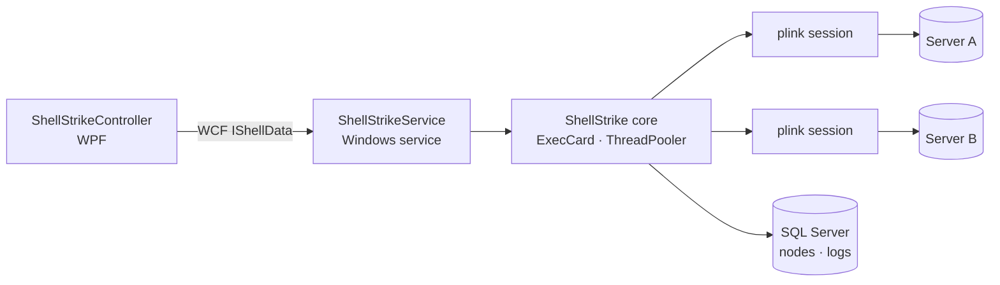

<div align="center">

# ⚡ ShellStrike

**Orchestrate scripted SSH sessions across fleets of servers — define command cards once, run them everywhere, watch the output live.**

[](https://github.com/mr-aybee/shell-strike/actions/workflows/ci.yml)


[](LICENSE)

</div>

---

## Overview

ShellStrike automates repetitive command-line work on remote servers. You describe a sequence of commands as an **execution card** — including the prompts to wait for and the "break cases" that decide what happens next — and ShellStrike drives interactive SSH sessions through PuTTY `plink` to run them on many nodes in parallel. A Windows service does the execution and exposes a WCF interface; a WPF controller lets operators manage nodes, launch cards and watch results.

## Features

- 🃏 **Execution cards** — reusable command sequences with expected-output matching
- 🔀 **Break cases** — branch or stop on specific output patterns
- 🖧 **Multi-node execution** with a thread pool
- 🧵 Interactive **plink** session handling, including host-key prompts
- 🧾 **Command logs** persisted to SQL Server
- 🖥️ **WPF controller** — node list, execution window, live input/output messages
- 🔌 **WCF service** (`IShellData`) between controller and executor

## Architecture



## Tech stack

| Component | Technology |
| --- | --- |
| Core | C# · .NET Framework 4.6 |
| Transport | PuTTY `plink.exe` (SSH) |
| Service | Windows service + WCF |
| Controller | WPF |
| Storage | SQL Server |

## Getting started

### Prerequisites

- Windows with .NET Framework 4.6+
- Visual Studio 2019+
- [PuTTY](https://www.putty.org/) installed (`C:\Program Files\PuTTY\plink.exe`)
- SQL Server for nodes and logs

### Build

```shell
git clone https://github.com/mr-aybee/shell-strike.git
cd shell-strike
nuget restore ShellStrike.sln
msbuild ShellStrike.sln /p:Configuration=Release
```

## Usage

1. Configure the database connection in `ShellStrikeService/App.config`.
2. Install and start the service (elevated shell):

   ```powershell
   sc.exe create ShellStrike binPath= "<path>\ShellStrikeService.exe" start= auto
   sc.exe start ShellStrike
   ```

3. Open **ShellStrikeController**, set the service endpoint in **Service Settings**, and add your nodes.
4. Create an execution card (commands, expected prompts, break cases).
5. Select nodes and run the card; follow progress in the **Execution** window.

> ⚠️ ShellStrike executes commands with the credentials you give it. Run it on a trusted network, use least-privilege accounts and never expose the WCF endpoint publicly.

## Project structure

```text
shell-strike/
├── ShellStrike/             # Core: Card/, Shell/PlinkHandler, WCFService/, logging, DB ops
├── ShellStrikeService/      # Windows service host
├── ShellStrikeController/   # WPF operator UI
├── ShellStrikeTest/         # Tests
└── TestPlink/, TestPlinkApp/ # plink and service-reference experiments
```

## Development

- Build the full solution with MSBuild; restore NuGet packages first.
- CI builds every project on Windows for each push and pull request.
- Test against disposable VMs, never production servers.

## Contributing

Contributions are welcome. Read [CONTRIBUTING.md](CONTRIBUTING.md) for the branch, build and pull-request workflow. Please report security issues privately through [GitHub security advisories](https://github.com/mr-aybee/shell-strike/security/advisories/new), not public issues.

## Code of Conduct

This project follows the [Contributor Covenant](CODE_OF_CONDUCT.md). By participating you agree to uphold it.

## License

Released under the [MIT License](LICENSE). © 2026 Abdullah Shahid.
